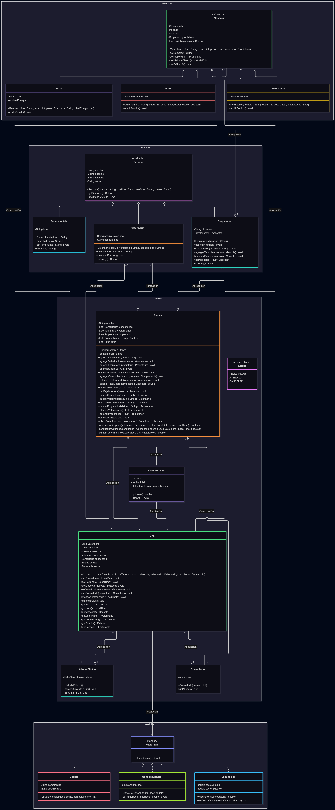
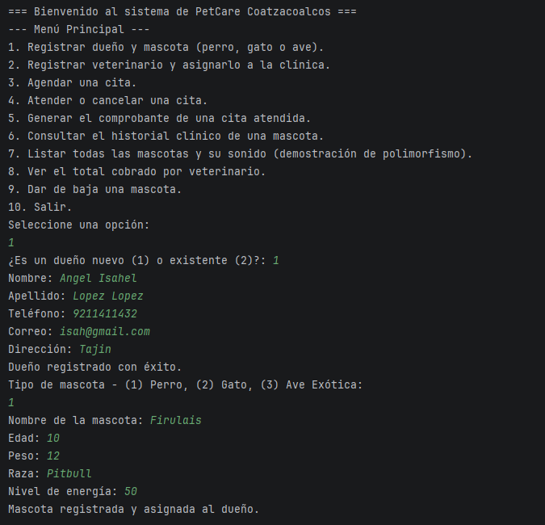
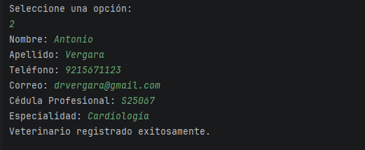
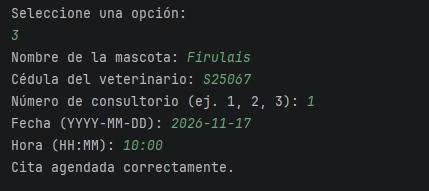
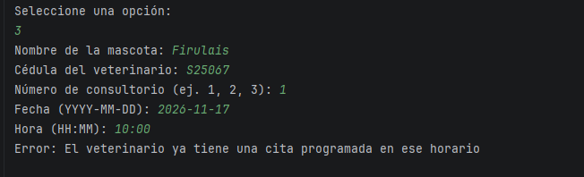
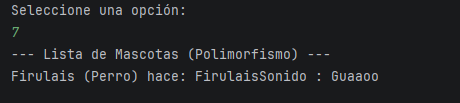
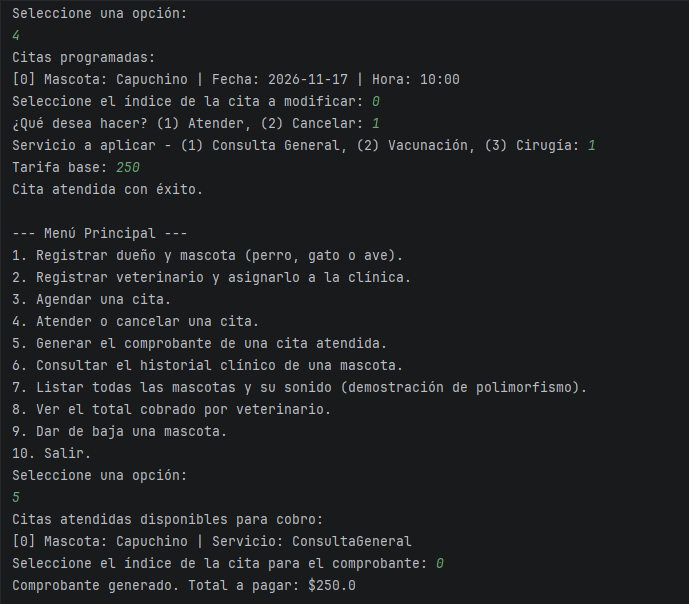

<a name="readme-top"></a>

<!-- PROJECT SHIELDS -->
<div align="center">
  
  
  
</div>

<!-- PROJECT LOGO -->
<br />
<div align="center">
  <h3 align="center">Sistema de Gestión Veterinaria "PetCare"</h3>

  <p align="center">
    Una solución de consola orientada a objetos para administrar el flujo operativo de una clínica veterinaria.
    <br />
  </p>
</div>

<!-- TABLE OF CONTENTS -->
<details>
  <summary>Tabla de Contenidos</summary>
  <ol>
    <li>
      <a href="#acerca-del-proyecto">Acerca del Proyecto</a>
      <ul>
        <li><a href="#tecnologías-utilizadas">Tecnologías Utilizadas</a></li>
        <li><a href="#modelo-de-la-solución">Modelo de la Solución</a></li>
        <li><a href="#reglas-de-negocio">Reglas de Negocio</a></li>
      </ul>
    </li>
    <li>
      <a href="#arquitectura-del-software">Arquitectura del Software</a>
      <ul>
        <li><a href="#estructura-del-proyecto">Estructura del Proyecto</a></li>
        <li><a href="#conceptos-aplicados">Conceptos Aplicados</a></li>
      </ul>
    </li>
    <li>
      <a href="#empezando">Empezando (Instalación y Ejecución)</a>
    </li>
    <li><a href="#ejemplo-de-uso">Ejemplo de Uso</a></li>
    <li><a href="#reflexión">Reflexión</a></li>
    <li><a href="#autor">Autor</a></li>
  </ol>
</details>

---

## Acerca del Proyecto

[PetCare es una aplicación de consola en Java diseñada para administrar de manera eficiente las operaciones diarias de una clínica veterinaria. Resuelve el problema del seguimiento manual de pacientes, automatizando el registro de dueños, la validación de agendas médicas y la facturación de servicios a través de un menú interactivo.]

### Tecnologías Utilizadas

* **Lenguaje:** Java (Versión 26) <!-- Cambia la X por tu versión de Java, ej. 21 -->
* **Modelado UML:** Mermaid live
* **Entorno de Desarrollo (IDE):** IntelliJ IDEA

### Modelo de la Solución

<!-- Inserta aquí la ruta real de tu imagen cuando la subas a GitHub -->


El sistema se diseñó siguiendo los principios de la Programación Orientada a Objetos para garantizar alta cohesión y bajo acoplamiento:
* **Herencia:** Se aplicó en la clase abstracta `Persona`, de la cual heredan `Propietario`, `Veterinario` y `Recepcionista`, centralizando atributos compartidos. `Mascota` es la clase base para `Perro`, `Gato` y `AveExotica`.
* **Interfaz:** Se definió `Facturable` con el método `calcularCosto()`. Esto obliga a los servicios (`ConsultaGeneral`, `Vacunacion`, `Cirugia`) a implementar su propia lógica matemática de cobro.
* **Agregación (`o--`):** Se utilizó para dependencias débiles. `Clinica` *agrega* `Veterinario`s y `Propietario`s, ya que estas personas existen físicamente de forma independiente al sistema de la clínica.
* **Composición (`*--`):** Se empleó para dependencias fuertes. `Clinica` *compone* `Consultorio`s (se instancian dentro de la clínica) y `Mascota` *compone* su `HistorialClinico` (su ciclo de vida está atado al paciente).

### Reglas de Negocio

| # | Regla | Dónde se valida |
| :--- | :--- | :--- |
| 1 | Peso y edad de la mascota no pueden ser 0 ni negativos | `Mascota.setPeso()` y `Mascota.setEdad()`, con `IllegalArgumentException`. Los constructores de Perro, Gato y AveExotica pasan por esos setters. |
| 2 | Un veterinario no puede tener dos citas programadas a la misma hora | `Clinica.agendarCita()`, mediante `veterinarioOcupado()`. Compara por cédula y solo cuenta citas PROGRAMADA. |
| 3 | Una cita cancelada no puede atenderse | `Cita.atenderCita()` |
| 4 | Un consultorio no puede usarse en dos citas a la vez | `Clinica.agendarCita()`, mediante `consultorioOcupado()`. También solo cuenta citas PROGRAMADA. |
| 5 | Los costos nunca son negativos | Setters de ConsultaGeneral (tarifa), Vacunacion (vacuna y aplicación) y Cirugia (horas de quirófano y complejidad). El total nunca sale negativo porque ninguno de sus componentes puede serlo. |
| 6 | Todo cobro se consulta por mascota y por veterinario | `Clinica.calcularTotalCobrado(Veterinario)` y `Clinica.calcularTotalCobrado(Mascota)` (la sobrecarga). |
| 7 | Una cita atendida no se puede cancelar | `Cita.cancelarCita()` |
| 8 | Una cita ya atendida no se puede atender otra vez | `Cita.atenderCita()` |
| 9 | La cita exige fecha, hora, mascota, veterinario y consultorio; y el servicio al atenderla no puede ser nulo | Setters de Cita y `Cita.atenderCita()` |
| 10 | El historial solo acepta citas atendidas y sin duplicar | `HistorialClinico.agregarCita()` |
| 11 | El comprobante solo se genera de una cita atendida | Constructor de `Comprobante` |
| 12 | Una cita solo tiene un comprobante y debe pertenecer a la clínica | `Clinica.agregarComprobante()` |
| 13 | Para agendar, la mascota, el veterinario y el consultorio deben pertenecer a la clínica | `Clinica.agendarCita()` |
| 14 | La cita que se agenda debe estar PROGRAMADA | `Clinica.agendarCita()` |
| 15 | El número de consultorio debe ser mayor que 0 y no repetirse; no se repiten veterinarios (por cédula) ni propietarios | `Consultorio.setNumero()`, `Clinica.agregarConsultorio()`, `agregarVeterinario()` y `agregarPropietario()` |
| 16 | Una mascota solo se agrega a su propio dueño | `Propietario.agregarMascota()` |
| 17 | Al dar de baja una mascota se cancelan sus citas programadas, y se conservan las atendidas con sus comprobantes | `Clinica.darBajaMascota()` |


---

## Arquitectura del Software

### Estructura del Proyecto

```text
src/
├── app/
│   └── Main.java       # Punto de entrada, menú interactivo y manejo de excepciones
└── modelo/
    ├── clinica/        # Lógica central: Clinica, Cita, Consultorio, Comprobante, Estado
    ├── mascotas/       # Entidades de pacientes: Mascota (abstracta), Perro, Gato, AveExotica
    ├── personas/       # Actores: Persona (abstracta), Propietario, Veterinario, Recepcionista
    └── servicios/      # Facturación: Facturable (interfaz), ConsultaGeneral, Cirugia, Vacunacion
```

### Conceptos Aplicados
| # | Regla | Dónde se valida |
| :--- | :--- | :--- |
| 1 | Peso y edad de la mascota no pueden ser 0 ni negativos | `Mascota.setPeso()` y `Mascota.setEdad()`, con `IllegalArgumentException`. Los constructores de Perro, Gato y AveExotica pasan por esos setters. |
| 2 | Un veterinario no puede tener dos citas programadas a la misma hora | `Clinica.agendarCita()`, mediante `veterinarioOcupado()`. Compara por cédula y solo cuenta citas PROGRAMADA. |
| 3 | Una cita cancelada no puede atenderse | `Cita.atenderCita()` |
| 4 | Un consultorio no puede usarse en dos citas a la vez | `Clinica.agendarCita()`, mediante `consultorioOcupado()`. También solo cuenta citas PROGRAMADA. |
| 5 | Los costos nunca son negativos | Setters de ConsultaGeneral (tarifa), Vacunacion (vacuna y aplicación) y Cirugia (horas de quirófano y complejidad). El total nunca sale negativo porque ninguno de sus componentes puede serlo. |
| 6 | Todo cobro se consulta por mascota y por veterinario | `Clinica.calcularTotalCobrado(Veterinario)` y `Clinica.calcularTotalCobrado(Mascota)` (la sobrecarga). |
| 7 | Una cita atendida no se puede cancelar | `Cita.cancelarCita()` |
| 8 | Una cita ya atendida no se puede atender otra vez | `Cita.atenderCita()` |
| 9 | La cita exige fecha, hora, mascota, veterinario y consultorio; y el servicio al atenderla no puede ser nulo | Setters de Cita y `Cita.atenderCita()` |
| 10 | El historial solo acepta citas atendidas y sin duplicar | `HistorialClinico.agregarCita()` |
| 11 | El comprobante solo se genera de una cita atendida | Constructor de `Comprobante` |
| 12 | Una cita solo tiene un comprobante y debe pertenecer a la clínica | `Clinica.agregarComprobante()` |
| 13 | Para agendar, la mascota, el veterinario y el consultorio deben pertenecer a la clínica | `Clinica.agendarCita()` |
| 14 | La cita que se agenda debe estar PROGRAMADA | `Clinica.agendarCita()` |
| 15 | El número de consultorio debe ser mayor que 0 y no repetirse; no se repiten veterinarios (por cédula) ni propietarios | `Consultorio.setNumero()`, `Clinica.agregarConsultorio()`, `agregarVeterinario()` y `agregarPropietario()` |
| 16 | Una mascota solo se agrega a su propio dueño | `Propietario.agregarMascota()` |
| 17 | Al dar de baja una mascota se cancelan sus citas programadas, y se conservan las atendidas con sus comprobantes | `Clinica.darBajaMascota()` |

### Instalación y Ejecución

1. Clona el repositorio:
   ```bash
   git clone [https://github.com/TU_USUARIO/petcare_Poo.git](https://github.com/TU_USUARIO/petcare_Poo.git)
   cd petcare_Poo
2.  Compila el código fuente
    ```bash
    javac -d bin src/app/Main.java src/modelo/*/*.java
3. Ejecuta la aplicación:
    ```bash
   java -cp bin app.Main
   
### Ejemplo de uso
1. Registrar dos dueños y tres mascotas (un perro, un gato y un ave).



2. Registrar dos veterinarios.

   

3. Agendar tres citas y atender dos, de modo que se calculen los costos de consultas, vacunación y cirugía.

   

4. Intentar agendar una cita que viole una regla de negocio y mostrar el mensaje de error.
   
   

5. Listar mascotas llamando emitirSonido() para mostrar el polimorfismo.

   

6. Mostrar el total cobrado y consultar historial clinico.

   


### Reflexión

A lo largo de este proyecto he comprendido mucho mejor cómo funciona la herencia; antes de esto, pensaba que era exactamente lo mismo que una clase abstracta. También aprendí a identificar con mayor claridad las relaciones UML (como agregación y composición) y en qué momento se debe ocupar cada una de ellas.

Lo que más se me dificultó fue, sin duda, la implementación de los bloques `try-catch`, ya que no había trabajado anteriormente con el manejo de excepciones. Además, me costó asimilar el propósito de algunos métodos que Java trae predeterminados, como `Collections.unmodifiableList`, `.equalsIgnoreCase()`, entre otros.

Finalmente, me apoyé de la IA como asistente de estudio para realizar correcciones de código, validar las relaciones de mis clases, estructurar profesionalmente el archivo README y construir el menú interactivo de la clase `Main`.

### Autor
Angel Isahel Lopez Lopez<br>
Estudiante de Ingeniería de Software - Universidad Verazcruzana

GitHub: @isahelop_

Gracias por todo :)

<p align="right">(<a href="#readme-top">volver arriba</a>)</p>
