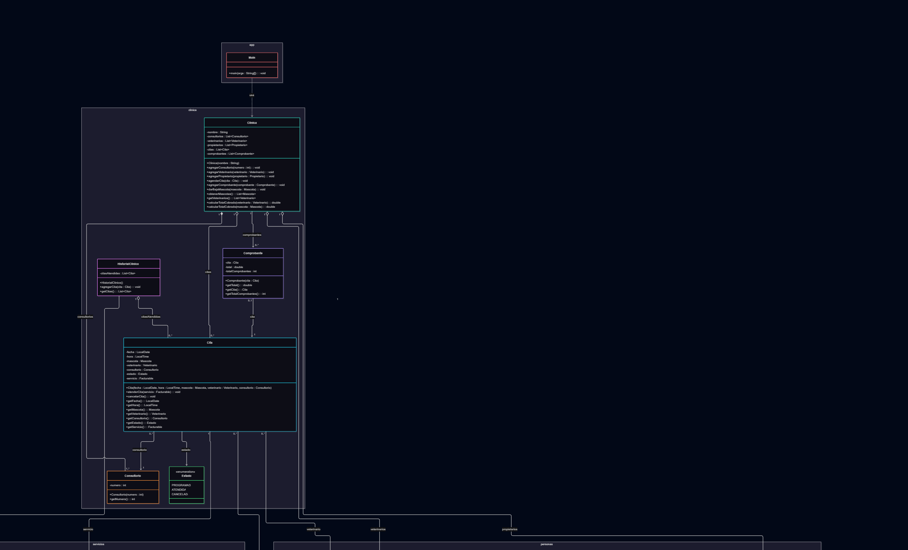

# Petcare
## Modelo de la solución

### Decisiones de diseño

**Herencia:** (qué jerarquías hay, qué comparte cada clase padre con sus hijas y por qué son abstractas)

**Interfaz:** (qué es Facturable, qué clases la implementan y qué ventaja te da)

**Agregación:** (qué relaciones usan agregación y, en una frase, por qué)

**Composición:** (qué relaciones usan composición y, en una frase, por qué)

La justificación completa de cada relación está en [docs/analisis.md](docs/analisis.md).